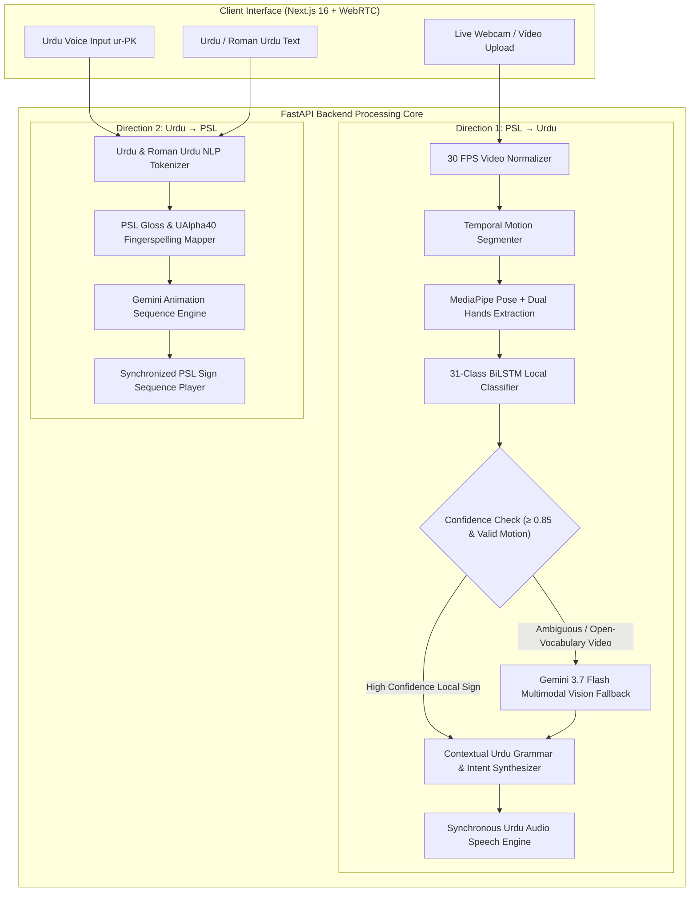

# SignSpeak 🇵🇰

### Two-Way Pakistani Sign Language (PSL) ⇄ Urdu Communication System & AI Tutor

[](https://nextjs.org/)
[](https://fastapi.tiangolo.com/)
[](https://ai.google.dev/)
[](https://www.typescriptlang.org/)
[]()
[](LICENSE)

---

## 🌟 Executive Overview

**SignSpeak** is an AI-powered assistive communication platform that breaks the communication barrier between Pakistan's **1.5+ million Deaf and Hard of Hearing (DHH)** citizens and the hearing community.

Pakistani Sign Language (PSL) is a distinct visual-spatial language with its own morphology, grammar, and syntax—completely independent from spoken Urdu and distinct from American Sign Language (ASL). Because qualified PSL interpreters in Pakistan are scarce (fewer than a few hundred certified interpreters nationwide), DHH individuals face severe systemic isolation in healthcare, education, legal proceedings, and public services.

SignSpeak delivers an **end-to-end, bidirectional, browser-accessible communication bridge** powered by high-speed local computer vision and Google Gemini multimodal intelligence.

---

## 🏛️ System Architecture

SignSpeak operates on a dual-engine architecture designed for high speed and open-vocabulary reliability:



---

## ✨ Core Features & Capabilities

### 1. 🤟 Direction 1: PSL to Urdu (Deaf → Hearing)
* **Real-Time Video Capture & Upload**: Stream directly from a desktop or mobile camera via WebRTC, or upload pre-recorded video files (`.mp4`, `.webm`).
* **5-Step Local Neural Pipeline**:
  1. *Video Preprocessing*: Uniformly resamples to 30 FPS and normalizes bounding frames.
  2. *Temporal Motion Segmentation*: Detects gesture boundaries through cumulative kinetic energy.
  3. *Landmark Extraction*: Tracks 75 holistic coordinates (Pose + Left Hand + Right Hand) using MediaPipe.
  4. *BiLSTM Neural Inference*: Classifies high-frequency core PSL signs at sub-150ms inference speeds.
  5. *Dual-Hand Verification*: Filters out idle postures, static frames, and single-hand noise.
* **Multimodal Gemini Vision Fallback (`gemini-3.7-flash`)**:
  * Automatically engages for multi-sign compound sentences and open-vocabulary signs outside the local training set.
  * Understands spatial orientation, facial expressions, and complex handshape dynamics.
  * Disambiguates delicate gestures (e.g., distinguishing mouth-directed signs like `WATER` from torso signs like `LESS`).
* **Natural Sentence Synthesis**: Transforms raw gloss strings (e.g., `ASSALAM-O-ALAIKUM WATER`) into fluent, grammatically polite Urdu sentences (`السلام علیکم، مجھے پانی چاہیے۔`) alongside English translations.
* **Synchronized Audio (TTS)**: Automatically vocalizes the translated Urdu text so hearing conversation partners hear the response instantly.

---

### 2. 🗣️ Direction 2: Urdu to PSL (Hearing → Deaf)
* **Flexible Multimodal Input**:
  * **Urdu Speech-to-Text**: Built-in Web Speech API calibrated for Pakistani Urdu (`ur-PK`).
  * **Native Urdu Script**: Direct Nastaliq / Arabic keyboard input.
  * **Roman Urdu Transliteration**: Automatic transliteration parsing (e.g., `doctor`, `madad`, `shukriya`, `pani`).
* **Hybrid Gloss Resolution**:
  * Translates spoken sentences into structured PSL gloss tokens.
  * High-speed dictionary lookups for core vocabulary signs.
  * Dynamic fallback to **UAlpha40** (Pakistani Sign Language fingerspelling alphabet) for names, locations, and rare nouns.
* **Interactive Sign Video Player**:
  * High-resolution visual sign demonstrations with smooth sequence queuing.
  * Playback speed controls: `0.6x` (slow-motion learning), `1.0x` (normal speed), and `1.4x` (quick review).
  * Frame-by-frame scrubbing, replay, and fullscreen modes.

---

### 3. 🎓 Interactive PSL Academy & Conversational AI Tutor (`/learn`)
* **Structured 4-Tier Curriculum**:
  * **Level 1 — Alphabets & Fingerspelling**: UAlpha40 complete character set with visual guides.
  * **Level 2 — Emergency & Medical Essentials**: Signs for `DOCTOR`, `HOSPITAL`, `HELP`, `WATER`, `POLICE`.
  * **Level 3 — Daily Life & Social Greetings**: Greetings, family terms, polite inquiries, and questions (`WHAT`, `WHERE`, `HOW`).
  * **Level 4 — Grammar & Reverse Practice**: Sign morphology, directionality, and spatial referencing.
* **Intelligent Conversational AI Tutor**:
  * **Conversational Memory**: Remembers topics discussed, past mistakes, and signs practiced throughout your session.
  * **Physical Gesture Descriptions**: Explains hand configuration, palm orientation, contact points, and physical motion trajectories.
  * **Interactive Quizzes**: Generates tailored multiple-choice challenges to reinforce retention.

---

### 4. 💬 SignBot Assistive Guide
* Specialized interactive assistant integrated across the application.
* Answers questions on Pakistani Sign Language culture, Deaf community communication etiquette, camera framing tips, and platform features.

---

## 🛠️ Technology Stack

| Layer | Technologies |
| :--- | :--- |
| **Frontend** | **Next.js 16** (App Router, Turbopack), **React 19**, **TypeScript**, Modern Glassmorphic CSS, Lucide Icons |
| **Backend** | **FastAPI** (Python 3.11), **Uvicorn** ASGI server, **Pydantic v2** |
| **AI & Computer Vision** | **Google Gemini 3.7 Flash** (Multimodal Vision), **MediaPipe** (Pose & Dual Hands Landmarkers), **TensorFlow / Keras** (BiLSTM) |
| **Datasets** | **WLPSL** (Word-Level Pakistan Sign Language), **UAlpha40** (Pakistani Sign Language Fingerspelling Alphabet) |
| **Speech & Audio** | Browser SpeechRecognition (`ur-PK`), Web SpeechSynthesis API |

---

## 📁 Repository Structure

```text
SignSpeak/
├── backend/
│   ├── app/
│   │   ├── api/
│   │   │   ├── psl_router.py           # PSL to Urdu translation endpoint
│   │   │   ├── urdu_psl_router.py      # Urdu to PSL gloss & animation endpoint
│   │   │   └── signbot_router.py       # Conversational SignBot assistant
│   │   ├── services/
│   │   │   ├── psl_pipeline.py         # 5-step local pipeline + fallback orchestrator
│   │   │   ├── psl_predictor.py        # Local BiLSTM gesture classifier
│   │   │   └── gemini_vision_fallback.py # Gemini 3.7 Flash multimodal vision engine
│   │   └── main.py                     # FastAPI application entry point
│   ├── tests/                          # Automated end-to-end and unit test suite
│   ├── requirements.txt                # Python dependencies
│   └── .env.example                    # Backend environment template
│
├── frontend/
│   ├── app/
│   │   ├── page.tsx                    # Two-way translator dashboard
│   │   ├── learn/page.tsx              # Interactive PSL Academy & AI Tutor
│   │   ├── api/tutor/route.ts          # AI Tutor streaming API route
│   │   └── globals.css                 # Glassmorphic UI theme & animations
│   ├── components/
│   │   ├── CameraPanel.tsx             # Video recording & landmark overlay
│   │   ├── UrduInputPanel.tsx          # Text & voice input with PSL player
│   │   ├── ChatBot.tsx                 # Floating SignBot assistant
│   │   └── learn/TutorChat.tsx         # AI Tutor conversation interface
│   └── package.json                    # Node.js dependencies
│
├── ml/
│   ├── inference/                      # Standalone feature extractors & segmenters
│   ├── models/                         # Model architecture definitions
│   └── training/                       # Kaggle / local training notebooks
│
├── docs/                               # Detailed technical & impact documentation
├── .env.example                        # Global environment variables template
├── setup.bat                           # Automated Windows installation script
└── start.bat                           # One-click dual-server launcher
```

---

## 🚀 Getting Started

### Prerequisites
* **Python**: `3.10` or `3.11`
* **Node.js**: `18.0.0` or newer (with `npm`)
* **Google Gemini API Key**: Obtain a free key from [Google AI Studio](https://aistudio.google.com/)

---

### 1. Clone the Repository

```bash
git clone https://github.com/AliHassaanDev/SignSpeak.git
cd SignSpeak
```

---

### 2. Environment Configuration

Copy the environment templates and insert your Gemini API Key:

```bash
# In the project root:
cp .env.example .env

# In the backend directory:
cp backend/.env.example backend/.env

# In the frontend directory:
cp frontend/.env.local.example frontend/.env.local
```

Edit `.env` (or `backend/.env` and `frontend/.env.local`):
```env
GEMINI_API_KEY=your_gemini_api_key_here
NEXT_PUBLIC_BACKEND_URL=http://localhost:8000
```

---

### 3. Installation

#### Automated Setup (Windows)
Double-click `setup.bat` or run:
```cmd
setup.bat
```

#### Manual Setup

**Backend Setup:**
```bash
python -m venv venv

# Windows:
.\venv\Scripts\activate
# macOS/Linux:
source venv/bin/activate

pip install -r backend/requirements.txt
```

**Frontend Setup:**
```bash
cd frontend
npm install
cd ..
```

---

### 4. Running the Application

#### Automated Launch (Windows)
Double-click `start.bat` or run:
```cmd
start.bat
```

#### Manual Launch

**Terminal 1 — FastAPI Backend:**
```bash
cd backend
python -m uvicorn app.main:app --host 127.0.0.1 --port 8000 --reload
```

**Terminal 2 — Next.js Frontend:**
```bash
cd frontend
npm run dev
```

Visit **[http://localhost:3000](http://localhost:3000)** in your browser!

---

## 🌐 Application Endpoints & Ports

| Service | Address | Description |
| :--- | :--- | :--- |
| **Frontend Portal** | [http://localhost:3000](http://localhost:3000) | Two-Way Translator & Video Recording |
| **PSL Academy (`/learn`)** | [http://localhost:3000/learn](http://localhost:3000/learn) | Interactive Curriculum & AI Tutor |
| **FastAPI Backend** | [http://127.0.0.1:8000](http://127.0.0.1:8000) | API Core & Health Status |
| **Interactive API Documentation** | [http://127.0.0.1:8000/docs](http://127.0.0.1:8000/docs) | Swagger UI for endpoint testing |

---

## 📡 REST API Reference

### 1. PSL Video to Urdu Translation
`POST /api/translate/psl-to-urdu`
* **Request**: `multipart/form-data` with `file: UploadFile` (video stream/file).
* **Response**:
```json
{
  "gloss": "ASSALAM-O-ALAIKUM WATER",
  "urdu": "السلام علیکم، مجھے پانی چاہیے۔",
  "english": "Hello, please give me water.",
  "confidence": 0.97,
  "source": "gemini_multimodal_vision (fallback)",
  "tokens": [
    { "id": "hello", "urdu": "السلام علیکم", "english": "hello", "gloss": "ASSALAM-O-ALAIKUM", "confidence": 0.98 },
    { "id": "water", "urdu": "پانی", "english": "water", "gloss": "WATER", "confidence": 0.97 }
  ]
}
```

### 2. Urdu Text to PSL Signs
`POST /api/text-to-psl`
* **Request**: `application/json`
```json
{
  "text": "مجھے ڈاکٹر چاہیے"
}
```
* **Response**:
```json
{
  "original_text": "مجھے ڈاکٹر چاہیے",
  "gloss_tokens": ["I", "DOCTOR", "WANT"],
  "animation_sequence": [
    { "gloss": "I", "video_url": "/videos/glosses/I.png", "type": "word" },
    { "gloss": "DOCTOR", "video_url": "/videos/glosses/DOCTOR.png", "type": "word" },
    { "gloss": "WANT", "video_url": "/videos/glosses/WANT.png", "type": "word" }
  ]
}
```

### 3. Conversational AI Tutor
`POST /api/tutor`
* **Request**: `application/json` with chat history and current inquiry.
* **Response**: Contextual guidance, physical gesture breakdown, and interactive quiz generation.

---

## 🧪 Automated Testing

SignSpeak includes a suite of unit, integration, and real-world video tests:

```bash
cd backend
python -m unittest tests/test_pipeline_e2e.py
python -m unittest tests/test_real_world_videos.py
```

---

## 🤝 Ethical AI & Community Commitment

* **Linguistic Respect**: SignSpeak treats Pakistani Sign Language as a rich, sovereign language with cultural identity, avoiding reductionist approaches.
* **Privacy First**: Video data processed via the local pipeline is executed in-memory and immediately discarded.
* **Community-Centric**: Developed to assist human interpreters and empower Deaf individuals in education, healthcare, and daily living.

---

## 📄 License

This project is licensed under the **MIT License** — see the [LICENSE](LICENSE) file for details.

---

<p align="center">
  <b>Built with ❤️ for Accessibility and Linguistic Inclusion in Pakistan 🇵🇰</b>
</p>